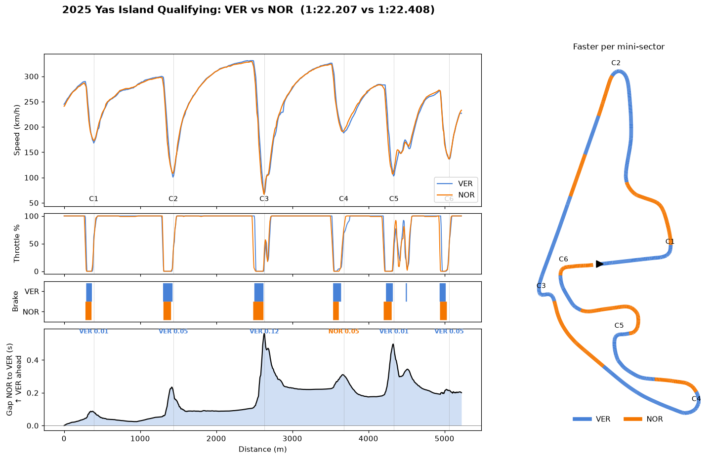
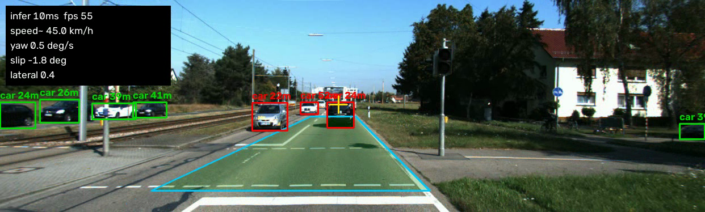

# motorsport-vision-telemetry-pipeline

Turns an onboard camera into a data channel, puts it on the same timeline as the car's telemetry, and shows where a lap is won or lost.

## What it is for

Rally and endurance teams log hundreds of car channels, but onboard video is mostly watched, not measured. This project treats the camera as one more sensor:

- **Video as data.** From the image alone: objects on the road and how far away they are, position across the road, distance to the apex, yaw rate, slip angle and speed. Useful where sensors are missing or need a cross-check: a camera-only test, a recce car, an onboard without telemetry.
- **One timeline.** Video and telemetry are aligned to the millisecond, so every frame can be read next to what the car was doing at that moment, live or after the run.
- **Where the time goes.** Two laps compared by distance: the gap at every metre, the time won or lost in each corner, and why (braking point, minimum speed, when full throttle comes back).

## What you get

- The whole stack on a laptop with one command (`make up`): Kafka-compatible broker, ClickHouse, Grafana dashboards. No cloud account.
- Live replay of a recorded run through the full streaming path, from camera frame to database in about 45 ms (p50).
- Accuracy measured against real ground truth (KITTI GPS/IMU, official F1 sector times, game telemetry), with the weak spots stated.
- The same analysis on real F1 data (OpenF1) and on your own laps from a racing game (Forza Motorsport on Xbox).

```
camera frames ─► cv-ai-worker (YOLOv8 + OpenCV) ─► Redpanda ─► ingester (Go) ─► ClickHouse ─► Grafana
GPS/IMU       ─► telemetry-producer ──────────────┘                    └─► LocalStack S3 (clips)
```

## Status

**Work in progress** until the real-time Forza recording is done.

- [x] Infra: Redpanda, ClickHouse, Grafana, LocalStack (`docker compose`)
- [x] CV worker: detection, road edges, optical flow, Kafka output
- [x] Sample data with real telemetry (KITTI) + accuracy check
- [x] Telemetry producer + live replay on a shared clock (`make demo`)
- [x] Go ingester (Kafka → ClickHouse) + joined view `frames_with_telemetry`
- [x] Grafana dashboard (auto-provisioned, live refresh)
- [x] Lap comparison on real F1 data: where time was gained or lost, and why
- [x] Own data from Forza Motorsport (Xbox): decoder, lap comparison, automatic video sync + camera calibration
- Real-time Forza recording: pending

## Quick start

```bash
make setup      # Python venv + deps
make up         # infra containers
make sample     # KITTI drive: front camera + GPS/IMU (~250 MB)
make cv         # -> output/annotated.mp4 + output/events.jsonl
make compare    # CV estimates vs real GPS/IMU
make demo       # live replay: telemetry + CV events to Redpanda (SHOW=1 for preview)
make laps       # real F1 laps compared: VER vs NOR, Abu Dhabi 2025 quali
```

## How video and telemetry stay in sync

Both streams carry their recorded timestamps. On replay, both services map them onto the same wall clock (`ts = start + (recorded − t0)`), with the same `run_id`, `start` and `t0` passed by `make demo`. The Go ingester writes both to ClickHouse, and the view `motorsport.frames_with_telemetry` joins each frame to its nearest telemetry sample, before or after it (two `ASOF JOIN`s), so it works for any sample rate (KITTI 10 Hz, Forza 60 Hz). Frames with no sample within 200 ms are left out. After a schema change, `make migrate` applies it to a running ClickHouse.

Measured on the KITTI sample:

| Step | Latency |
|---|---|
| Frame ↔ telemetry sample (sync gap) | 1–13 ms |
| Telemetry producer → Kafka | p50 4 ms |
| Frame time → CV event in Kafka (includes inference) | p50 32 ms, p95 39 ms |
| Kafka → ClickHouse (Go ingester, 50 ms batches) | p50 12 ms, p95 ~15 ms |

## Lap comparison: where time is won

`make laps` takes two real laps and finds where one driver gains on the other, corner by corner:



```
make laps A=VER B=NOR EVENT="Yas Marina" YEAR=2025 SESSION=Qualifying

VER 1:22.207  vs  NOR 1:22.408  (gap +0.201 s, track 5223 m)
Delta checked against official sector times: max error 0.036 s, corrected

C3  @ 2630 m  NOR loses 0.121 s  -  VER: brakes 15 m later
C4  @ 3675 m  VER loses 0.047 s  -  NOR: full throttle 60 m earlier
...
```

How it works:

1. **Distance, not time.** Speed is integrated into distance, so both laps can be compared at the same point on track. The gap at each metre is the time difference there.
2. **Corners** are the clear speed dips. A chicane with no real straight between its two dips counts as one corner.
3. **Time per corner** is measured from the straight before to the straight after. This is where the gap line is most reliable.
4. **Why**: braking point, minimum speed, where full throttle comes back, top speed after. Only differences above the data resolution are reported (15 m, 3 km/h).
5. **Check against official timing.** The distance from integrated speed drifts a few metres, so the gap is compared with the official F1 sector times. Measured error over 6 laps: mean 0.03 s, max 0.10 s. The gap is then corrected to match them.

The output goes to `output/laps_*.png` and to the Grafana dashboard **Lap Comparison**. That dashboard shows the gap, speed, throttle and brake by distance, a track map of who is faster every 200 m, and the corner table.

The analysis only needs time, speed, throttle, brake and x/y per sample, so the same code works on game telemetry.

Data: [OpenF1](https://openf1.org) (free historical data, no account). FastF1 needs a paid F1 TV login since 2026. Samples come about 4 times a second, so braking points are ±15 m. The gap line can swing inside slow corners, but the corner totals stay reliable.

## Own data: Forza Motorsport on Xbox

Video and telemetry from the same drive, with true values for everything the CV worker estimates (speed, yaw rate, slip angle) at 60 Hz.

```
Xbox ─HDMI─► Elgato capture card ─USB─► Mac: OBS records the video (1080p60, bumper camera)
Xbox ─"Data Out" UDP (Wi-Fi/LAN)─────► Mac: record_udp_telemetry.py stores raw packets + PC clock time
```

In the game: Settings → Gameplay & HUD → Data Out **On**, IP = the Mac's address, port `5300`. Then:

```bash
python3 scripts/record_udp_telemetry.py --port 5300   # while driving; OBS records at the same time
# put telemetry_*.csv and the OBS .mp4 in one folder, e.g. sample-data/forza/2026-11-23_monza
make forza-decode FORZA=sample-data/forza/2026-11-23_monza   # raw packets -> telemetry.csv, lap times
make forza-laps   FORZA=...   # fastest vs second fastest lap, corner by corner (Grafana: Lap Comparison)
make forza-cv     FORZA=...   # CV on the video
make forza-sync   FORZA=...   # exact video offset + camera FOV/height -> sync.json
make forza-cv     FORZA=...   # again, now calibrated
make forza-sync   FORZA=...   # final accuracy: video vs game
make forza-demo   FORZA=...   # live replay through Kafka -> ClickHouse -> Grafana
```

How it works:

- **Store raw, decode later.** Packets are saved as they arrive. `decode_forza.py` reads them (Forza Motorsport 2023 and 7 layouts) into one CSV with the project's units and signs. Wi-Fi delays packets by a few ms, sometimes 50+, so each sample uses the game's own clock, shifted to the PC clock by the smallest delay seen in each 2 s window.
- **Video start.** OBS names the file by its start time, to the second. The capture card and OBS add a delay on top. `sync_video.py` finds the exact offset by matching the yaw rate seen in the video to the game's yaw rate (cross-correlation). Before matching, the game signal gets the same smoothing and frame timing as the CV worker, so the worker's own lag cancels out.
- **Camera calibration.** Video yaw scales with focal length, video speed with focal length × camera height. Fitting both against the game gives the camera's real FOV and height, without a calibration target.
- **Lap comparison** uses the same code as F1. The lap time comes from the game, and the integrated distance is checked against the game's odometer.

Tested on synthetic packets and video estimates with a known offset and camera: the offset, FOV and height came back exact. Real numbers go in the tables above once a session is recorded.

UIs: Grafana http://localhost:3000 (Vision + Telemetry and Lap Comparison dashboards, no login) · Redpanda Console http://localhost:8080

Run `make demo` and watch the dashboard update live (pick the newest run in the *Run* dropdown).

> The CV worker runs natively, not in Docker, so it can use the Apple Silicon GPU (MPS).

## Data

Video sources need real telemetry recorded with them to be useful here; broadcast onboards don't have it. The sample uses a **KITTI raw** drive: front camera frames plus GPS/IMU (speed, yaw rate, position) with timestamps for every frame. `make sample` fetches only those files from the archive, not the full 1.2 GB.

> KITTI raw data © Geiger, Lenz, Stiller, Urtasun — *Vision meets Robotics: The KITTI Dataset*, IJRR 2013. Licensed [CC BY-NC-SA 3.0](https://creativecommons.org/licenses/by-nc-sa/3.0/). The data is not included in this repo; the annotated frame below is shared under the same license.

## What the CV worker measures



| Field | How |
|---|---|
| `detections`, `n_hazards` | YOLOv8 (cars, people, animals). Distance from pinhole model: `f · real_height / box_height`. Hazard = within 60 m and on the road |
| `lateral_offset` | Canny + Hough road edges. -1 = left edge, 0 = centre, +1 = right edge |
| `apex_dist` | Distance to the inside edge while cornering (0 = on the apex) |
| `yaw_rate_deg_s` | Sideways optical flow of far points |
| `slip_angle_deg` | Angle between camera heading and the focus of expansion (true travel direction) |
| `speed_est_kmh` | Ground-point flow + camera height (flat road assumption) |

## Accuracy (vs KITTI GPS/IMU)

KITTI drive `2011_09_26_drive_0015`, 297 frames, `make compare`:

| Signal | Mean abs error | Correlation | Note |
|---|---|---|---|
| Speed | 5.1 km/h (true mean 42 km/h) | 0.87 | |
| Yaw rate | 1.4 °/s | 0.20 | Mostly straight drive (true yaw within ±1.4 °/s), so this is mostly noise. Needs a drive with corners |

## Benchmarks

Measured by the worker itself (`make cv` prints p50/p95). Only real numbers go here.

| Machine | Input | YOLO p50 | Pipeline FPS |
|---|---|---|---|
| Apple Silicon (MPS), yolov8n | KITTI 1242x374 | 8.6 ms | ~60 |
